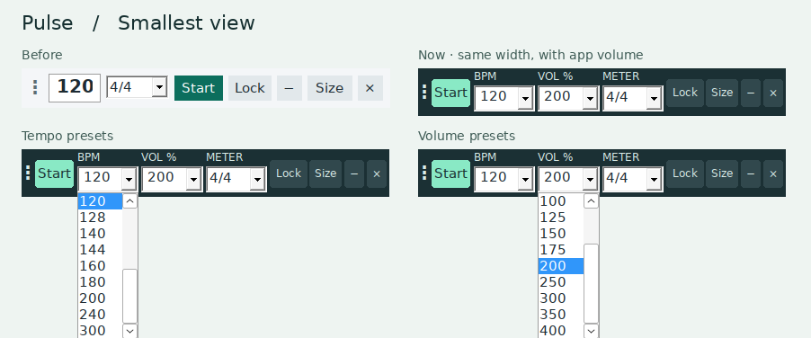

# Pulse 0.4.0 · controls and measured beat levels

The smallest bar is still 410 logical pixels wide. Tempo, Pulse volume and
meter sit together, next to Start/Stop. Open a selector for presets or type an
exact BPM or percentage. Enter or leaving the gain field commits it; hovering
and scrolling a closed selector, canceling an open menu, or pausing midway
through typing a percentage should not change playback gain.



[Compact comparison](compact-comparison.png) · [Editor comparison](editor-comparison.png)
· [Practice tools comparison](practice-comparison.png). Before panels are the
archived Wine captures of the previous layout; after panels are real window
pixels from a private Wine/Xvfb desktop (96 DPI), arranged together for comparison.
A separate native check exercised the built executable on a **never-activated
Windows desktop**, at 288 DPI. It found a 1230 × 162 pixel client, checked all
eight controls for clipping/overlap, and opened both dropdowns without playback.

## What could make beats different?

- The old application had an accented rendering branch: a different pitch and
  gain for downbeats/groups, subdivisions and second pulses. Older preset files
  could switch it back on. The new engine has **one voice**; all audible events
  restart it at the same gain and pitch. Coincident events cannot sum. An entire
  practice uses a common tail-length cap for its grid at a fixed tempo.
  Preset format 6 has no accent flag or groups; the loader validates then
  discards those legacy fields in versions 1–5.
- Pulse's app gain is a constant multiplier before a memoryless soft peak
  limiter, not a compressor that increases its gain after quiet passages.
  Raising gain deliberately does raise level. For a clean click the measured
  increase from 100% to 200% was **6.02 dB**; doubling again from 200% to
  400% gave **5.32 dB**, less than 6.02 because the boosted peaks are limited.
  Returning to 200% restored the original measured energy. The separate Windows
  master slider is changed only by its own scroll notification, not by setting
  the app gain. Tests read, but did not change, Windows output volume.
- The [previous long run](../ten-minute-audit/README.md) did **not** establish
  a repeating loud beat. All four beat positions changed level over time; the
  two stable plateaus matched 200% and 400% waveforms. Without telemetry that
  run cannot establish what changed the setting or what the listener heard.

## Evidence and repeatability

In the fixed-gain Windows run (160 BPM, clean tone, 4/4), **1,601 complete
clicks over ten minutes had identical samples**: 0.00 dB RMS and peak spread,
zero measured spectral difference and exactly 18,000 frames between onsets.
All 2,404 level readbacks showed 200% Pulse gain, the same session volume and
unchanged Windows output. The final-source 100% → 200% → 400% → 200% sweep
also had zero spread within each setting.

The offline suite checked 342,570 clicks across 3,816 settings, including all
four sounds, silence, coincident events and dense/mixed grids. Maximum waveform
difference and energy spread at fixed settings were zero. A deliberately
attenuated synthetic fixture (never a production option) registered 6.02 dB,
verifying that the analysis detects unequal clicks. FFmpeg independently
cross-checked full-click RMS and peaks.

Native tests used 48 kHz stereo **process-only** WASAPI loopback, not a microphone
or system-wide recording. The hidden test process played at 15% session volume.
Readbacks roughly every 250 ms track UI gain, the audio worker's requested
gain, test session level/mute and endpoint level/mute. This can distinguish
sustained gain shifts; it is not continuous telemetry of every downstream audio
effect. The endpoint did not supply an effects-disable value, so no conclusion
about speaker, headphone or driver enhancements follows from that property.

- [Gain sweep: energy by setting](gain-sweep.json)
- [Whole-click measurements and telemetry ranges](native-summary.json)
- [Waveform and spectrogram of the fixed-gain run](long-spectrum.png)
- [Level over time, old recording vs. controlled run](level-comparison.png)

Run in a clean output directory (large raw captures are local/ignored):

```bash
bash scripts/test.sh
bash scripts/build.sh
bash scripts/test-ui.sh
bash scripts/test-evenness.sh build/offline
# On Windows via the WSL share, run scripts/test-evenness-windows.ps1
# separately with -OutputDirectory build/sweep -GainSweep, and
# -OutputDirectory build/long -TenMinutes -Bpm 160 -Gain 200.
PY=~/tools/pulse-audio-venv/bin/python
for d in build/sweep build/long; do
  "$PY" scripts/analyze-evenness.py "$d" --native --renderer build/evenness_audit --expect-flat
  "$PY" scripts/verify-evenness-ffmpeg.py "$d" --expect-flat
done
"$PY" scripts/check-gain-sweep.py build/sweep
"$PY" scripts/summarize-four-four.py build/long
```

These are development-aware digital tests, not an independent listening test.
They exclude incomplete capture-edge clicks and retain complete interior tails;
there is no per-click gain normalization or time stretching. Optional device
positions are unavailable on this loopback path. The real-time ten-minute test
started during the UI work; the separate gain sweep was repeated on the final
app sources after the UI and preset changes.
