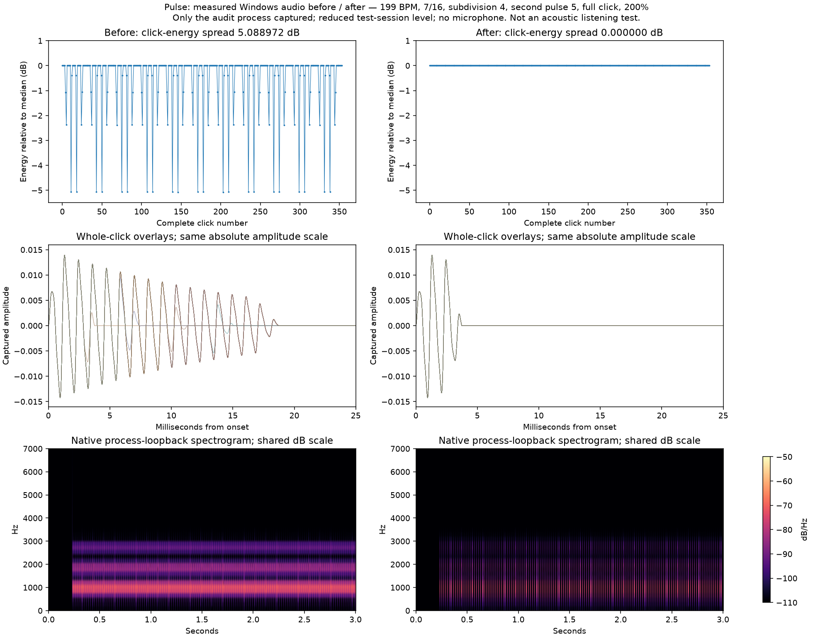

# Intensive pulse-evenness audit — Pulse 0.3.2, 2026-11-02



**Result:** a reproducible software defect was found and fixed. With accents off, old clicks had different tail lengths on irregular/dense grids, despite equal initial gain and pitch. Full-click energy varied by up to **15.813163 dB** in the offline matrix. The illustrated native Windows case (199 BPM, 7/16, subdivision 4, second pulse 5, full click, 200%) varied by **5.088972 dB before, 0 dB after**. These are digital energy ratios, not speaker sound-pressure or perceived-loudness measurements.

**Important:** ordinary clean 120/160 BPM with no extra pulse was already bit-identical in the digital tests and measured Windows captures. This does not establish the cause of every uneven pulse Rok hears in that ordinary setup. Physical output and Windows endpoint processing remain separate questions.

## Fix

`flatClickFrames` computes one conservative envelope length from the union of the subdivision and second-pulse grids, across every sequence step. Every unaccented pulse uses that same envelope, including after silent beats and at meter/loop boundaries. Coincident pulses still become one click. Fractional sample intervals can no longer change individual tail lengths. The audio worker refreshes the envelope's main-tempo input at a live tempo boundary.

Sparse normal clicks keep their existing waveform. Dense practices necessarily shorten **all** clicks consistently; their absolute energy can differ from a sparse practice, but it no longer alternates from pulse to pulse. Deliberate sound/gain changes and accents ON remain meaningful. Defaults remain 200%/accents OFF. This change does not import the pending UI redesign or change preset format.

## Coverage and results

| Check | Coverage / measured result |
| --- | --- |
| Core regression | 272,566 checks under ASan/UBSan; defaults, presets, gain, waveform equality, timing/drift and fixed-envelope bounds |
| Full-click matrix (also repeated under ASan/UBSan) | 3,888 cases; 343,722 scheduled audible clicks, **342,570 unaccented clicks** and 72 intentionally accented positive-control cases; **970,899,377 synthesized samples** |
| Flat matrix before / after | 2,904 strict equality failures before; **0 after**. After: exactly zero sample, energy and peak differences, not just “under tolerance” |
| Matrix dimensions | All four sounds; 100/200/400% dense Cartesian grid; every second-pulse count 0–16; subdivisions 1–4; 137/199/300 BPM dense cases; 1,200 reproducibly seeded mixed-meter/rate/mute/gain cases; explicit 120/160 BPM at 0/1/70/100/200/275/400%; 44.1/48/96 kHz portable rendering |
| Native Windows static playback | 17 scenarios, including all four sounds at 200/400%, ordinary 120/160 BPM, dense second pulses, positive accents, and a 60-second 160 BPM run. **1,781 complete unaccented clicks**: zero energy/peak/sample/spectral differences, correlation 1 |
| Native live playback | Nine stable phases during continuous playback: 137→199→300→137 BPM, gain 200→400→200, sound change, accents ON/OFF. **1,168 complete unaccented clicks**: zero energy/peak/sample/spectral differences, correlation 1 |
| Separate DSP cross-check | FFmpeg `astats` independently computes each exported cell's RMS/peak/finite counts; confirms 0 dB variation after and detects the native before defect. This is separate measurement code, **not independent behavioral testing** |
| Positive controls | Native plain accent control: 3.663478 dB energy spread; live dense accented control: 8.354835 dB. Detectors do not simply report everything as equal |
| Measurement-tool validation | Ten synthetic known-good/known-bad tests: gain changes, first-click difference, truncated tails, polarity reversal, equal-energy frequency changes, missing clicks, irregular spacing, end-boundary context, partial-initial-packet alignment |
| Startup / installation | Nine Linux/Wine startup assertions; native installed-app verifier checks 200% edit/slider, accents OFF, shortcuts and existing tiny-bar controls. See work log for installed hash/path |

The matrix is broad and deterministic, **not every possible setting combination**. Silent beats intentionally omit sound; accent-enabled controls intentionally differ. Explicit sound/gain changes are compared within stable phases, not against each other.

## Measurement method and safeguards

- The C++ sweep uses the actual timeline/synthesizer and the audio worker's per-bar lookahead, including the first synthesized click. Every event cell covers its complete waveform up to the next onset and is zero-padded to the same 100 ms analysis window. It checks finite/bounded samples, energy, peak, sample difference and correlation. Silent events do not falsely split a still-audible cell.
- This is stronger than the earlier audit, which compared only a shortest-gap prefix. Equal prefixes/peaks can hide differing tails and therefore differing total energy. The new regression requires exact equality, rather than accepting 0.01 dB variation.
- NumPy/SciPy measurements additionally compare full FFT magnitudes and spectral centroids. Spectrograms use a shared absolute color scale; waveform overlays are **not gain-normalized**. Only the energy chart uses clearly labelled energy relative to its median.
- Native capture uses Microsoft's process-scoped WASAPI loopback API: **only this audit process**, not other applications or a microphone. The harness exercises real native controls and the real audio worker. Only its own test-session volume is reduced to 15%; Windows master volume and enhancement settings are untouched.
- Whole-grid correlation establishes one capture offset. It does not shift every static click independently. Live retiming leaves fractional sample anchors; the live-phase analyzer may locate the actual zero-to-attack edge within **±1 sample**, and records every correction. It never stretches or rescales a waveform. Regular 120/160 BPM native spacing is checked against the sample-clock period.
- Several native recordings contain a partial/omitted leading render packet. These leading incomplete clicks and the explicit Stop boundary are reported/excluded; **native cold-start waveform uniformity is not established by these captures**. The cause of those leading partials is not resolved here. Full offline renders include their first click. Live phases have a two-second settling interval and three-second measurement; this does not establish transition latency or absence of transient effects during intentional changes.
- Process loopback provides no usable physical device position in this environment (all zero). An initial endpoint-style counter incorrectly labelled every packet a gap; the corrected recorder and analysis report device-position continuity as **unavailable/null**, not as a passed gap test. Discontinuity/timestamp flags were zero; waveform/onset checks supplement them. Original baseline logs remain local with this limitation documented.
- This is development-aware testing by the implementing agent. It does **not** test acoustic speaker/headphone output, Bluetooth/hardware DSP, perceived grouping, every Windows audio configuration, or an independent listener. Endpoint effects metadata was unavailable, so no effects-enabled/disabled conclusion is drawn.

## Evidence

- [Offline before matrix](offline-before.csv), [offline after matrix](offline-after.csv), [counts](offline-summary.json).
- [Windows before metrics](native-before-analysis.json), [Windows after metrics](native-after-analysis.json), [live metrics](native-live-analysis.json).
- FFmpeg cross-checks: [before](native-before-ffmpeg-analysis.json), [after](native-after-ffmpeg-analysis.json), [live](native-live-ffmpeg-analysis.json).
- Raw float captures, every-click tables, spectra, individual plots and runtime logs remain in ignored `build/evenness-*`, `build/native-before`, `build/native-after`, `build/native-live-final`. No microphone/user-media recording or audio credentials are stored in Git.

## Repeat

Linux dependencies are pinned in `tests/audio-requirements.txt`; use a Linux venv, not a Windows toolchain. See `docs/TOOLCHAIN.md`.

```bash
bash scripts/test.sh
bash scripts/test-evenness.sh
bash scripts/build.sh
# Optional full sanitizer sweep:
g++ -std=c++20 -O1 -g -fsanitize=address,undefined -fno-omit-frame-pointer \
  tests/evenness_audit.cpp -o build/evenness_sanitized
ASAN_OPTIONS=detect_leaks=0 build/evenness_sanitized build/evenness-sanitized
```

The Linux suite also compiles `build/windows_evenness_audit.exe`. Run `scripts/test-evenness-windows.ps1` on native Windows for static captures, or `-OutputDirectory build/native-live-final -Live` for live changes. It plays reduced-level test clicks in its own process and preserves existing Pulse windows. Then analyze in Linux:

```bash
PY=/home/rokdbest/tools/pulse-audio-venv/bin/python
$PY scripts/analyze-evenness.py build/native-evenness --native \
  --renderer build/evenness_audit --expect-flat
$PY scripts/verify-evenness-ffmpeg.py build/native-evenness --expect-flat
```

Use the corresponding output folder for live captures. Captures require Windows build 20348+; failure is reported rather than falling back to recording the entire desktop. Building/re-running the baseline requires `50191e9` application headers, not the fixed headers.

Method references: [Microsoft process-loopback sample](https://learn.microsoft.com/en-us/samples/microsoft/windows-classic-samples/applicationloopbackaudio-sample/), [FFmpeg audio filters](https://ffmpeg.org/ffmpeg-filters.html), [SciPy spectral analysis documentation](https://docs.scipy.org/doc/scipy/reference/generated/scipy.signal.spectrogram.html).
