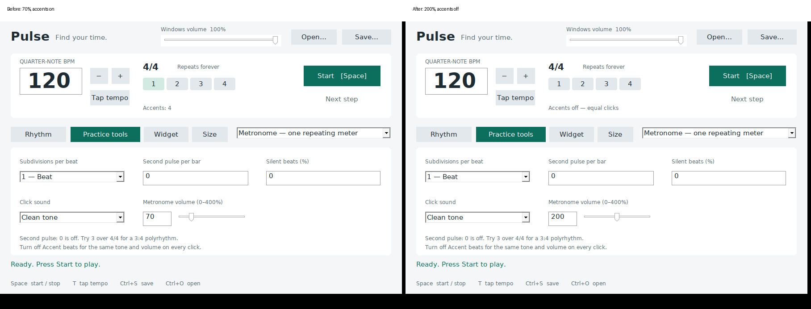

# Startup defaults — 2026-11-02

These are development-aware Linux/Wine `PrintWindow` + child `WM_PRINT` composites, not physical Windows screenshots. Wine omits the accent checkbox in these captures; the header text and beat highlighting show its setting, and the GUI test directly asserts the checkbox state. The known Wine frame/black-margin rendering limitation is unchanged.

The before executable was compiled from `c89617d` application source before modifying defaults; the after executable uses this branch's application source. Both run the same startup test in a new task-local Linux Wine prefix. No playback or Windows system-volume changes were triggered.

Checks in each startup run: launch, volume edit, volume slider, accent checkbox, tools visibility, settings retained across view changes, manual accent toggle, manual volume synchronization, clean close. Nine assertions pass before (70%/on baseline) and after (200%/off regression).

Recheck the fix with `bash scripts/test-startup.sh`; screenshots are written to ignored `docs/startup-after.bmp`, and runtime/logs stay in ignored `build/`. The script uses only its own `build/wine-startup` prefix, not shared Wine sessions. Captured PNGs here preserve the reviewed before/after evidence. Core audio/default/preset checks run with `bash scripts/test.sh`.
