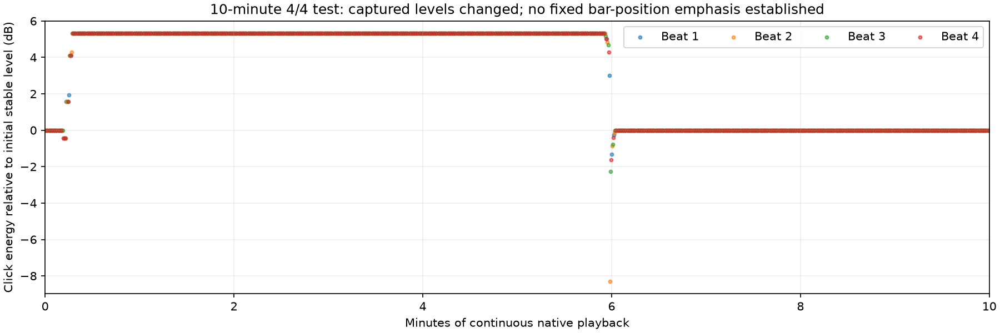

# Real-time ten-minute 4/4 audit — 2026-11-08

**Result: FAIL / cause unresolved.** Do not treat this run as a clean, uniform
playback pass or as a reproduction of one permanently accented bar position.



## What actually ran

- Native Windows application test instance, compiled in Linux from the same
  Pulse 0.3.2 application/audio sources as commit `1ffa332`. No production source
  was modified. Installed 0.3.2 executable hash still matches the previously
  verified `e9e89d7ded835987307cf7a4800a5ee13784ff5c6c0ca283e0e73945050bd119`.
- Initial settings: **160 BPM, 4/4, subdivision 1, no second pulse, no silent
  beats, Clean tone, 200% metronome gain, accents OFF**. User did not supply BPM
  or sound before the run; these are stated assumptions, not their confirmed
  exact setup. No installed Pulse process was running before the test.
- Ran from 12:16:17 to 12:26:26 Europe/Ljubljana. The long playback itself lasted
  **601,000 monotonic milliseconds**. Captured **28,870,560 stereo frames at
  48 kHz = 601.47 seconds**, including capture start/stop margins. This was a
  real-time native run, not a fast offline ten-minute render.
- Recorded only the audit process through process-scoped WASAPI loopback; no
  microphone or other-app audio. Reduced only this test audio session to 15%;
  did not change Windows master volume, endpoint effects, installed app files,
  shortcuts, or any existing practice. The test instance closed itself.
- Followed with a separate six-second accents-ON positive control.

## Measurements

| Measurement | Result |
| --- | --- |
| Complete captured clicks analyzed | **1,601**, including 1,599 in the first scheduled 600 seconds |
| Whole-run energy/RMS spread | **13.611387774 dB**; FFmpeg independently agrees at 13.611388 dB |
| Whole-run peak spread | **10.653133021 dB**; FFmpeg agrees at 10.653133 dB |
| All measured click intervals | **18,000 frames = 0.375 s**, no measured spacing variation |
| Mean-energy difference across numbered positions 1–4 | **0.009640771 dB**; this small aggregate difference does not reproduce a persistent accented position |
| Each beat position's minute-to-minute mean spread | **5.330–5.355 dB**; temporal level changes affect every position |
| Positive accent control | **3.663478317 dB** energy spread, detected by both analyzers |
| Stereo difference / discontinuity / timestamp flags | Zero; optional device positions unavailable, **not** a passed device-position continuity test |

The first roughly 11 seconds have one stable level. Levels transition over the
next few seconds to a plateau about **5.3206 dB higher**, then change around
minute six and settle back. Minutes 2–5 and 8–10 each have bit-identical click
energies across all four positions within their respective stable plateau.
The largest whole-run spread includes a brief transition dip, not a repeating
13.6 dB accent on a particular beat.

Additional reference comparison: early captured whole clicks match the actual
synthesizer's **200%** waveform; the upper plateau matches its **400%** waveform.
Both fits use effectively the same post-render scale (~0.022500002), correlation
1, and maximum absolute residual below 1.7e-9. This is strong evidence of a
change resembling the app's pre-limiter gain, not merely a fixed louder beat.
It is **not** a logged observation of the volume control changing.

## Important unresolved control/measurement limits

The harness sets controls before playback and sends no control changes during
the 601-second long capture, but its window remains interactive. This run did
**not** log app control values, requested gain, session-volume readbacks or
external input continuously. Therefore we cannot establish that settings stayed
at 200% throughout, distinguish interaction from an automatic app change, or
attribute the level shifts to Pulse versus the rest of the audio path solely
from the recording. Asked Rok whether the test window/volume was adjusted;
no answer was available when this report was written. Do not call this a
controlled unchanged-gain pass.

One leading partial click was reported/excluded, and the final stop boundary
was excluded; full interior tails are retained. Beat numbering is inferred from
the globally aligned scheduler reference, not independently timestamped visual
beat notifications. Absolute bar phase can be ambiguous if an entire startup
click is missing; the overall inequality and temporal changes do not depend on
the labels. No per-click gain normalization, stretching, or alignment correction
was applied to this static run. This is a digital recording, not an acoustic
speaker/headphone test or independent behavioral review.

Next useful controlled run: log the actual gain/accent controls and audio-session
volume throughout playback (and correlate any changes) before attributing a
cause or making another audio fix. No product/audio fix was made for this test.

## Evidence and repeat commands

- [Capture duration/settings](capture.csv), [whole-click analysis](analysis.json),
  [FFmpeg cross-check](ffmpeg-analysis.json), [per-beat/per-minute summary](numbered-summary.json).
- Raw captures and every-click tables remain ignored in `build/native-ten-minute`:
  main raw SHA256 `596022cde46ea2fcb277bd211397a3f7d32c10158a6c473d8fb5d53d69252137`
  (230,964,480 bytes); control raw SHA256
  `80246bbdeed555cf818c776c09c06dfff0d8eb5360afe0aa75c8678239604d88`.
- Reusable harness accepts `--long-only BPM SOUND GAIN`; PowerShell runner
  accepts `-TenMinutes -Bpm 160 -Sound 0 -Gain 200`, uses a 12-minute safety
  timeout, and kills only its own audit process if that timeout expires.

```bash
# Build native audit in Linux using the command in scripts/test-evenness.sh.
# Run on Windows against this Linux worktree:
# scripts/test-evenness-windows.ps1 -OutputDirectory build/native-ten-minute -TenMinutes
PY=/home/rokdbest/tools/pulse-audio-venv/bin/python
$PY scripts/analyze-evenness.py build/native-ten-minute --native --renderer build/evenness_audit --expect-flat
$PY scripts/verify-evenness-ffmpeg.py build/native-ten-minute --expect-flat
$PY scripts/summarize-four-four.py build/native-ten-minute
```

All three analysis commands intentionally return nonzero for this measured run.
Do not discard their failures. Measurement-tool validation passed 10 existing
known-signal tests plus 6 new numbered-beat/drift tests, including a synthetic
beat-3 gain increase after five minutes and startup-click numbering safeguards.
Core suite: 272,566 ASan/UBSan checks passed. Warning-clean Linux MinGW harness
build and PowerShell parser check passed. No dependency/toolchain update.

Method context: [Microsoft process-loopback scope](https://learn.microsoft.com/en-us/samples/microsoft/windows-classic-samples/applicationloopbackaudio-sample/)
and [Windows session-volume controls](https://learn.microsoft.com/en-us/windows/win32/coreaudio/session-volume-controls).
These APIs describe capture/volume behavior, not the established cause here.
